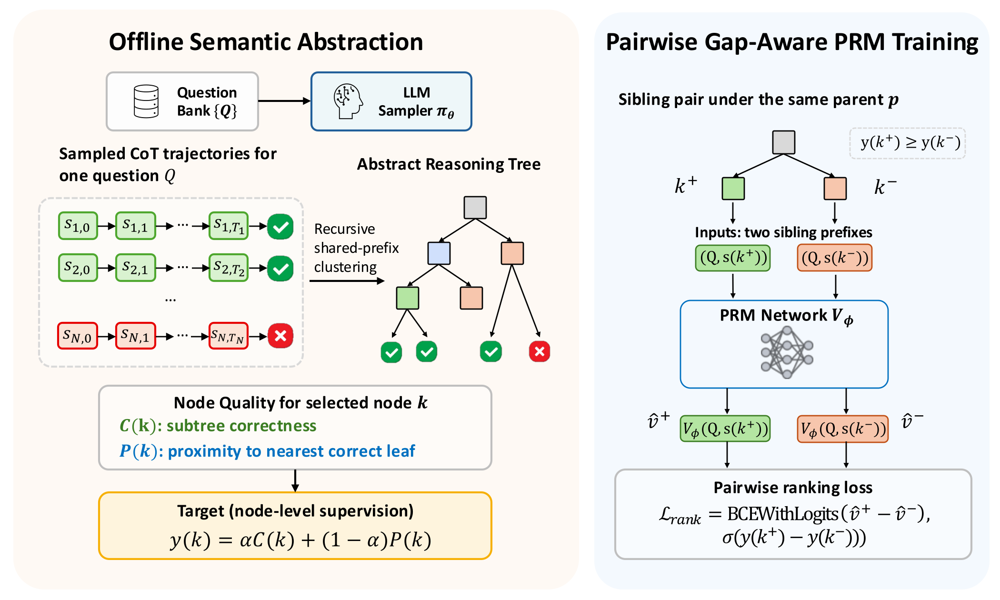

# MedCoast

[](https://huggingface.co/zhongys97/medcoast)

MedCoast improves medical question answering by scoring an LLM's reasoning step by step and steering it toward steps that lead to correct answers. Instead of costly expert labels, it derives step-level supervision automatically: sampled chain-of-thought trajectories are merged into an abstract reasoning tree, and each node is scored by how often and how quickly it reaches a correct answer. A lightweight process reward model learns to rank sibling steps from these scores, then guides search at inference without fine-tuning the policy model. The same PRM also generalizes well across backbones, improving policy models it never saw during training.

<p align="center">
  
</p>


The pipeline:

1. Sample many reasoning trajectories per question from an LLM.
2. Merge similar steps across trajectories into a reasoning tree (steps are clustered by cosine similarity).
3. Give every node a value from how often its subtree reaches the correct answer and how close it is to the shortest correct leaf.
4. Train a pairwise PRM (ModernBERT-base) to rank sibling steps by value.
5. Use the PRM to guide MCTS or best-of-N at inference.

> TODO: add paper link and citation.

## Pretrained PRMs

The trained PRMs are on Hugging Face at [zhongys97/medcoast](https://huggingface.co/zhongys97/medcoast). The paper uses `medcoast_prm_dsim0.8_a0.0.pt` (dsim = 0.8, a = 0.0).

- **dsim** is the cosine-similarity threshold used to merge steps into tree nodes (`--cutoff` in the code).
- **a** is the weight on the node's correct-answer rate in its value. The remaining `1 - a` goes to the depth ratio (`--weight_correct` in the code).

Download one:

```bash
huggingface-cli download zhongys97/medcoast medcoast_prm_dsim0.8_a0.0.pt --local-dir checkpoints
```

Load it with `PRMScorer`:

```python
from model.prm_scorer import PRMScorer

scorer = PRMScorer(api_keys_json_path="api_keys.json",
                   base_model_name="answerdotai/ModernBERT-base",
                   ft_model_path="checkpoints/medcoast_prm_dsim0.8_a0.0.pt")
```

## Setup

The code was run with Python 3.12, PyTorch 2.8 (CUDA 12.8), and vLLM 0.10.2.

```bash
conda create -n medcoast python=3.12 -y
conda activate medcoast
pip install -r requirements.txt
```

Fill in your Hugging Face token in `api_keys.json`. Only `HUGGINGFACE_HUB_TOKEN` needs a value. Keep the other keys in the file, since some scripts read them, but they can stay empty. `HF_HOME` is optional.

Run all commands from the repository root.

## Data

| Dataset | Train | Val | Test |
|---|---|---|---|
| MedQA | 10,178 | 1,272 | 1,273 |
| MedMCQA | 91,411 | 1,046 | 2,091 |
| PubMedQA | 800 | 100 | 100 |
| BioASQ | 167 | 42 | 325 |
| MedQuAD (out-of-distribution) | – | – | 1,641 |
| MedXpertQA (out-of-distribution) | – | – | 2,450 |
| MMLU medical (out-of-distribution) | – | – | 1,111 |

The processed splits are in `data/processed/{train,val,test}/<dataset>_<split>.json`, and their sizes are in `data/processed/metadata.json`. MedQuAD, MedXpertQA, and MMLU are test-only.

To rebuild the splits from source, uncomment the datasets you need in `data/download_ds.py` and run it from `data/`. Then delete `data/processed/`; the trajectory collector rebuilds the splits on its next run. All sampling uses `random_state=42`.

```bash
cd data && python download_ds.py && cd ..
```

## Training a PRM

### 1. Collect trajectories

Sample reasoning trajectories for each question:

```bash
python -m preprocessing.trajectory_collector \
    --model_name Qwen/Qwen3-8B --dataset_name MedQA --split train \
    --use_vllm --num_trajectories 200 --batch_size 100
```

Samples are written to `data/samples/`. Repeat for each dataset (`MedQA`, `MedMCQA`, `PubMedQA`, `BioASQ`) and for the `train` and `val` splits.

### 2. Build reasoning trees

```bash
python -m preprocessing.tree_builder \
    --dataset_name MedQA --split_name train --cutoff 0.8 --build_chains
```

`--cutoff` is dsim. `--build_chains` parses the raw samples into step chains first, written to `data/chains/`. Trees are saved as pickles under `data/trees/<split>/<dataset>_<split>/cutoff_<dsim>/`.

### 3. Build training shards

Turn the trees into sibling-step pairs, pre-tokenized into WebDataset shards:

```bash
for split in train val; do
  python -m training.build_wds_shards \
      --split $split --cutoff 0.8 --weight_correct 0.0 \
      --tree_base ./data/trees/$split
done
```

`--weight_correct` is a. Shards are written to `data/shards/<split>_cutoff<dsim>_wc<a>/shard-*.tar`. Inputs are capped at 2048 tokens.

### 4. Train

```bash
python -m training.train_ranker_wds \
    --train_prebuilt_pairs_path "./data/shards/train_cutoff0.8_wc0.00/shard-{000000..NNNNNN}.tar" \
    --val_prebuilt_pairs_path   "./data/shards/val_cutoff0.8_wc0.00/shard-{000000..NNNNNN}.tar" \
    --cutoff_ratio 0.8 --weight_pct_leaf_correct 0.0 \
    --output_dir ./data/pairwise_prm
```

Replace `NNNNNN` with the index of the last shard in each folder. The checkpoint with the best validation pairwise accuracy is saved as `best_prm.pt`, and per-step metrics go to `train_history.jsonl`. Defaults: `answerdotai/ModernBERT-base`, learning rate 5e-6, batch size 32, early-stopping patience 20 evaluations.

## Evaluation

All evaluation goes through `evaluate_qa.model_evaluator`, and `--configs` picks the method. Point `--ft_bert_model_path` at a PRM checkpoint, either downloaded or trained yourself.

| `--configs` | Method | Main options |
|---|---|---|
| `one_pass` | Single answer | – |
| `self_consistency` | Majority vote over N samples | `--num_answers_needed` |
| `best_of_n` | N full answers, keep the one with the highest PRM score | `--num_answers_needed` |
| `mcts_direct` | PRM-guided MCTS | `--mcts_simulation`, `--mcts_max_tree_depth`, `--mcts_max_search_depth`, `--mcts_branch_k`, `--mcts_c_puct` |

Examples:

```bash
PRM=checkpoints/medcoast_prm_dsim0.8_a0.0.pt
TEST=./data/processed/test

# Without a PRM
python -m evaluate_qa.model_evaluator --model_name meta-llama/Llama-3.1-8B-Instruct \
    --configs one_pass self_consistency --processed_qa_pairs_jsons_dir $TEST \
    --num_answers_needed 30 --bertscore_device cuda

# MCTS
python -m evaluate_qa.model_evaluator --model_name meta-llama/Llama-3.1-8B-Instruct \
    --configs mcts_direct --processed_qa_pairs_jsons_dir $TEST --bertscore_device cuda \
    --ft_bert_model_path $PRM --mcts_simulation 20 --mcts_max_tree_depth 20 \
    --mcts_max_search_depth 4 --mcts_branch_k 4 --mcts_c_puct 1.2

# Best-of-N
python -m evaluate_qa.model_evaluator --model_name meta-llama/Llama-3.1-8B-Instruct \
    --configs best_of_n --processed_qa_pairs_jsons_dir $TEST --bertscore_device cuda \
    --ft_bert_model_path $PRM --num_answers_needed 16 --batch_size 16
```

Results are saved to `evaluation_results/<config>/<model>/<dataset>/`. Pass `--seed` to fix the random seed; results then go under `<config>_seed<seed>`. Multiple-choice datasets are scored by accuracy. Free-text datasets (BioASQ, MedQuAD) are scored with BERTScore and ROUGE.

### Models evaluated

- **In-distribution policy models** (with and without PRM-guided search): `Qwen/Qwen3-8B`, `google/gemma-2-9b-it`, `meta-llama/Llama-3.1-8B-Instruct`
- **Out-of-distribution policy models** (with and without PRM-guided search): `mistralai/Ministral-3-8B-Instruct-2512`, `allenai/Olmo-3-7B-Instruct`, `microsoft/Phi-3.5-mini-instruct`

## Repository layout

```
common/          LLM setup and calls, prompts, BERTScore/ROUGE
preprocessing/   trajectory collection, chain parsing, tree building
training/        WebDataset shard builder and pairwise PRM trainer
model/           PRM scorer, MCTS, reasoning tree
evaluate_qa/     evaluation entry point (model_evaluator)
data/            download script and processed splits
```

## License

The code and the released PRM checkpoints are licensed under the [Apache License 2.0](LICENSE).
